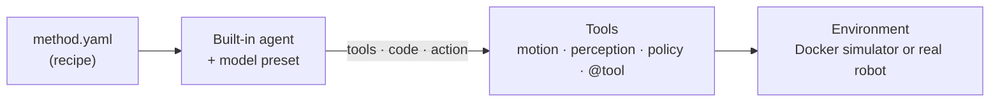

<div align="center">

<h1>EvoAB</h1>

<b>Evolving Agents with Bodies</b><br>
An open framework for building, reproducing and composing robot-use agents

[](LICENSE)
[](pyproject.toml)
[](https://github.com/Elvin-yk/EvoAB/issues/34)
[](docs/guide.md)
[](https://github.com/Elvin-yk/EvoAB/issues/11)

</div>

**EvoAB turns any LLM-agent robotics method into a short YAML recipe** that runs
on any model, in any supported simulator or on a real robot, and composes freely
with other methods. What [StarVLA](https://github.com/starVLA/starVLA) is for
VLAs, EvoAB aims to be for robot agents.

Robot-use agents keep a frozen general-purpose model and differ in the harness
around it. EvoAB makes that harness out of shared parts:

- **Three ways to act, nothing else.** An agent calls tools, writes programs that
  call the same tools, or emits action chunks directly.
- **Everything else is a tool.** Motion, perception, a VLA or world-action
  policy, and your own Python functions (`@tool`) plug in the same way.
- **The recipe is the method.** Inputs, roles, tools, budgets and experience
  across episodes live in one file; the command line only picks the run.
- **Same environments for everyone.** Benchmarks run in Docker with their native
  scoring; the agent never sees the verdict.



## News

- **2026/11** One agent: every method runs on the built-in agent over your model presets.
- **2026/11** Your own tools: decorate a Python function with `@tool` and select it in a recipe.
- **2026/11** Benchmarks run only in Docker; `evoab run` starts and stops the container itself.
- **2026/11** RoboDojo: 42 tasks in five capability dimensions, with selectable seeds and layouts.

## Quickstart

Linux, Python 3.11 and Docker. MetaWorld needs no GPU.

```bash
git clone https://github.com/Elvin-yk/EvoAB.git && cd EvoAB
python3.11 -m venv .venv && source .venv/bin/activate
pip install -e '.[agent]'

export MY_API_KEY=...                                  # any OpenAI-compatible endpoint
evoab models add-provider "My API" --base-url https://host/v1 --key-env MY_API_KEY
evoab models add-preset my-model --provider my_api --model MODEL_ID

evoab setup --integration metaworld                    # builds the benchmark image once
evoab run --integration metaworld --task reach-v3 --recipe agentic --model my-model --output-dir ./runs
evoab replay ./runs                                    # step through what the agent saw, did and spent
```

Or paste this into a coding agent on the target machine:
*Install EvoAB by following the "Install" section of https://github.com/Elvin-yk/EvoAB/blob/main/docs/guide.md; ask me before any sudo.*

## Try these

| Command | What it does |
|---|---|
| `evoab run --integration robodojo --task stack_bowls --recipe agentic --model my-model` | One agent calls robot tools on a dual-arm RoboDojo task |
| `… --recipe direct_action` | The model emits action chunks itself, as in Astranomy's Direct form |
| `… --recipe code_as_policy` | The agent writes and runs Python programs against the robot API |
| `… --set inputs.depth=false` | Same method, RGB-only observations |
| `… --recipe direct_action --set 'roles.main.action.horizon=[16,32]'` | Change any recipe value for one run |
| `evoab benchmarks tasks robodojo` | Tasks with their dimension, real instruction and step limit |
| `evoab methods list` | Every method and where its `method.yaml` lives |

## Methods

Each method is a directory with `method.yaml` (the recipe, commented line by
line) and `CARD.md` (paper, setting, results).

| Method | Acts through | Idea |
|---|---|---|
| `agentic` | tools | Observe, call tools, decide from feedback |
| `clean` | tools | Four tools and compact results; a minimal baseline |
| `direct_action` | action | One stateless request per action chunk ([Astranomy](https://research.nvidia.com/labs/srl/projects/astranomy/)) |
| `code_as_policy` | code | Programs against the robot API ([Code as Policies](https://arxiv.org/abs/2209.07753)) |
| `code_iterate` | code | Programs kept across episodes after successes ([RAX](https://arxiv.org/abs/2610.22496)) |
| `agent_policy` | tools + policy | The agent hands contact-rich motion to a VLA and checks it |
| `tool_team` | tools | Several roles that delegate sub-goals to each other |

More reproductions are on the [method roadmap](https://github.com/Elvin-yk/EvoAB/issues/34).

## Environments

| Environment | Robot | Notes |
|---|---|---|
| RoboDojo | Dual-arm ARX X5, Isaac Sim | 42 tasks, 5 capability dimensions, policy tool (Pi0.5) |
| MetaWorld | Sawyer, MuJoCo | CPU only; fastest check |
| LIBERO · LIBERO-Plus · LIBERO-PRO | Panda | Standard, perturbed and robustness suites |
| RoboTwin 2.0 | ALOHA-AgileX | Dual-arm |
| CALVIN | Panda | Policy tool (StarVLA) |
| Your own | Any | Name your Docker image in a manifest |
| ARX ONE · Piper-X | Real dual-arm robots | Same tools as simulation |

Policy and SAM3 services are yours to start; pass `--action-model-url` or `--sam3-url`.
Preparing each environment: [benchmarks](docs/benchmarks.md).

## Documentation

[Guide](docs/guide.md) (install, models, running, recipes, results, SDK) ·
[Architecture](docs/architecture.md) (how it is built and extended) ·
[Benchmarks](docs/benchmarks.md) (preparing environments) ·
[AGENTS.md](AGENTS.md) (rules for contributors and coding agents)

## Contributing

Work is posted as issues on the [task board](https://github.com/Elvin-yk/EvoAB/issues/11);
anyone can claim one. Decisions are collected in
[#42](https://github.com/Elvin-yk/EvoAB/issues/42). Read [AGENTS.md](AGENTS.md),
develop with `pip install -e '.[dev,agent]'`, and open pull requests against
`main` that link their issue.

## License

MIT. Third-party code, assets and models keep their own licenses; each
integration's `SOURCE.md` records its provenance.
