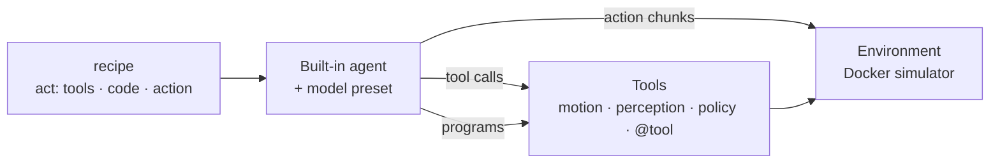

<div align="center">

<h1>EvoAB</h1>

<b>Evolving Agents with Bodies</b><br>
An open framework for building, reproducing and composing robot-use agents

[](LICENSE)
[](pyproject.toml)
[](https://github.com/Elvin-yk/EvoAB/issues/34)
[](docs/guide.md)
[](https://github.com/Elvin-yk/EvoAB/issues/11)

</div>

**EvoAB turns any LLM-agent robotics method into a short YAML recipe** that runs
on any model, in any supported simulator, and composes freely
with other methods. What [StarVLA](https://github.com/starVLA/starVLA) is for
VLAs, EvoAB aims to be for robot agents.

Robot-use agents keep a frozen general-purpose model and differ in the harness
around it. EvoAB makes that harness out of shared parts:

- **Three ways to act, in any combination.** An agent calls tools, writes
  programs that call the same tools, or emits action chunks directly; a recipe
  enables any mix of the three (`act: [tools, code, action]`).
- **Everything else is a tool.** Motion, perception, a VLA or world-action
  policy, and your own Python functions (`@tool`) plug in the same way.
- **The recipe is the method.** How it acts, inputs, roles, tools, budgets and
  experience across episodes live in one file; the command line only picks the run.
- **Same environments for everyone.** Benchmarks run in their published Docker
  images with native scoring; EvoAB's code is mounted, never baked in, and the
  agent never sees the verdict.



## News

- **2026/11** Tools, code and action combine freely in one agent session; the method library is the three of them.
- **2026/11** One agent: every method runs on the built-in agent over your model presets.
- **2026/11** Your own tools: decorate a Python function with `@tool` and select it in a recipe.
- **2026/11** Benchmarks run in published images only (LIBERO, LIBERO-PRO, CALVIN); code changes never rebuild an image.

## Quickstart

Linux, Python 3.11, Docker and an NVIDIA GPU with the NVIDIA Container Toolkit.

```bash
git clone https://github.com/Elvin-yk/EvoAB.git && cd EvoAB
python3.11 -m venv .venv && source .venv/bin/activate
pip install -e '.[agent]'

export MY_API_KEY=...                                  # any OpenAI-compatible endpoint
evoab models add-provider "My API" --base-url https://host/v1 --key-env MY_API_KEY
evoab models add-preset my-model --provider my_api --model MODEL_ID

evoab setup --integration libero --runtime-profile libero_spatial   # pulls AllenAI's LIBERO image once
evoab run --integration libero --runtime-profile libero_spatial --recipe tools --model my-model \
  --task pick_up_the_black_bowl_between_the_plate_and_the_ramekin_and_place_it_on_the_plate --output-dir ./runs
evoab replay ./runs                                    # step through what the agent saw, did and spent
```

Or paste this into a coding agent on the target machine:
*Install EvoAB by following the "Install" section of https://github.com/Elvin-yk/EvoAB/blob/main/docs/guide.md; ask me before any sudo.*

## Try these

| Command | What it does |
|---|---|
| `evoab run --integration calvin --task open_drawer --recipe tools --model my-model` | One agent calls robot tools on a CALVIN task |
| `… --recipe code` | The agent writes and runs Python programs against the robot API |
| `… --recipe action` | The model emits action chunks itself, as in Astranomy's Direct form |
| `… --set 'roles.main.act=[tools,code,action]'` | One agent that may call a tool, run a program or emit a chunk at each step |
| `… --set inputs.depth=false` | Same method, RGB-only observations |
| `… --recipe examples/recipes/policy.yaml` | A VLA policy as one more tool (`actor_act`) |
| `evoab benchmarks tasks calvin` | Tasks with their instruction and step limit |
| `evoab methods list` | Every method and where its `method.yaml` lives |

## Methods

An agent acts in three ways. Each is a built-in method (`method.yaml`, commented
line by line, and `CARD.md`), and a recipe can enable any combination:

| Method | `act` | What the model does |
|---|---|---|
| `tools` | `[tools]` | Observes, calls tools and decides from their feedback |
| `code` | `[code]` | Writes programs that call the same tools ([Code as Policies](https://arxiv.org/abs/2209.07753)) |
| `action` | `[action]` | Emits action chunks, one stateless request each ([Astranomy](https://research.nvidia.com/labs/srl/projects/astranomy/)) |

Everything else is a recipe option over these three: a VLA policy as a tool
([`policy.yaml`](examples/recipes/policy.yaml)), programs kept across episodes
as in RAX ([`code_iterate.yaml`](examples/recipes/code_iterate.yaml)), a
four-tool baseline ([`clean.yaml`](examples/recipes/clean.yaml)), all three ways
in one session ([`all.yaml`](examples/recipes/all.yaml)), or several roles that
delegate to each other. More reproductions are on the
[method roadmap](https://github.com/Elvin-yk/EvoAB/issues/34).

## Environments

| Environment | Robot | Notes |
|---|---|---|
| LIBERO · LIBERO-PRO | Panda, MuJoCo | Standard and robustness suites; policy tool (StarVLA) on LIBERO |
| CALVIN | Panda, PyBullet | One task per episode; policy tool (StarVLA) |
| Your own | Any | Name your Docker image in a manifest |

Policy and SAM3 services are yours to start; pass `--action-model-url` or `--sam3-url`.
Preparing each environment: [benchmarks](docs/benchmarks.md).

## Documentation

[Guide](docs/guide.md) (install, models, running, recipes, results, SDK) ·
[Architecture](docs/architecture.md) (how it is built and extended) ·
[Benchmarks](docs/benchmarks.md) (preparing environments) ·
[AGENTS.md](AGENTS.md) (rules for contributors and coding agents)

## Contributing

Work is posted as issues on the [task board](https://github.com/Elvin-yk/EvoAB/issues/11);
anyone can claim one. Decisions are collected in
[#42](https://github.com/Elvin-yk/EvoAB/issues/42). Read [AGENTS.md](AGENTS.md),
develop with `pip install -e '.[dev,agent]'`, and open pull requests against
`main` that link their issue.

## License

MIT. Third-party code, assets and models keep their own licenses; each
integration's `SOURCE.md` records its provenance.
